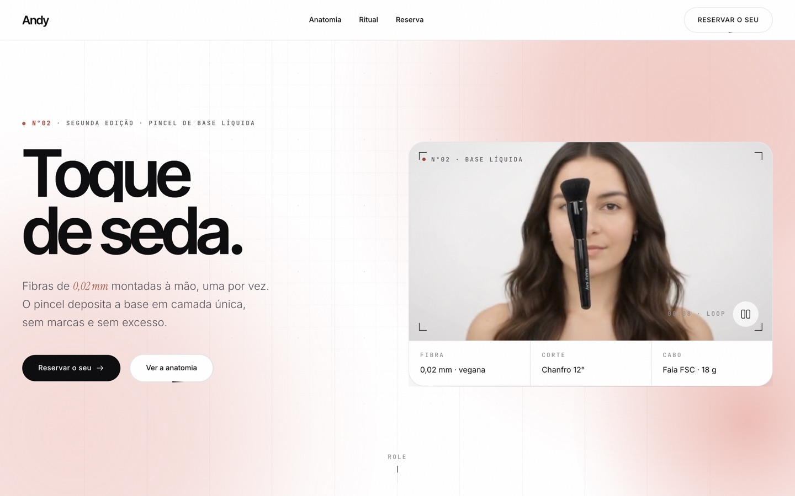
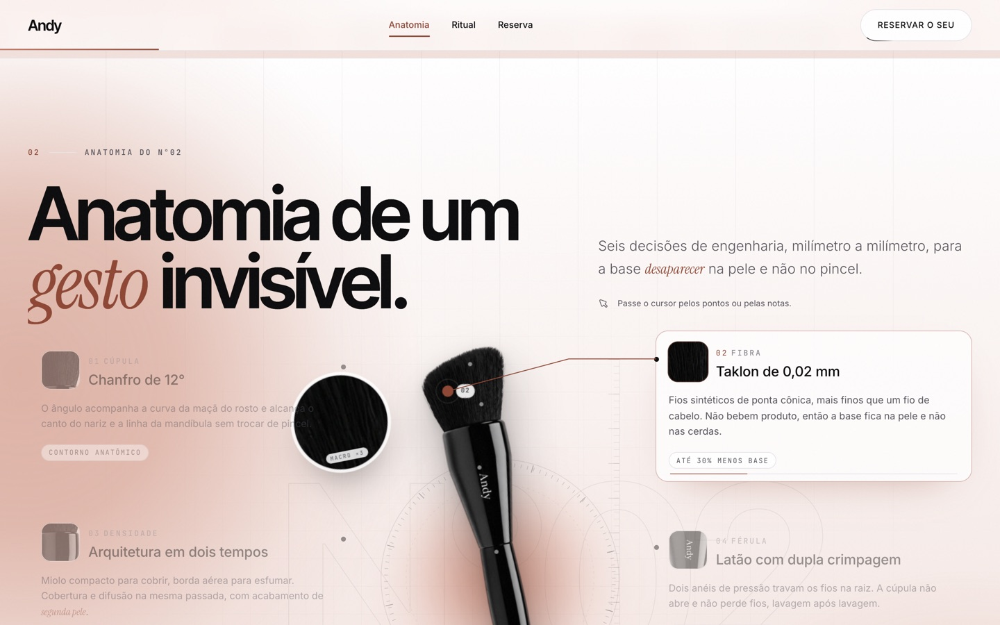

# Andy · Pincéis feitos à mão

Site no ar em [illustrious-ganache-89e735.netlify.app](https://illustrious-ganache-89e735.netlify.app/).





Landing page do pincel Andy N°02. HTML estático: para ver, basta servir a pasta.
O único passo de build é o Tailwind, e a folha gerada está versionada, então dá
para abrir a página sem rodar nada.

## Estrutura

```
index.html                  a página inteira
MAPA-DE-SECOES.md           inventário das dobras e regra da navegação
assets/css/tailwind.css     gerado por build/ (não editar à mão)
assets/css/fonts.css        as @font-face das quatro famílias (não editar à mão)
assets/css/andy.css         os estilos da marca
assets/js/andy.js           todo o comportamento, em 15 blocos numerados
assets/fonts/               os woff2 das quatro famílias, subsets latin e latin-ext
assets/img/                 imagens servidas ao navegador (WebP)
assets/video/               pincel.mp4 e pincel.webm, comprimidos
build/                      config do Tailwind e a página que gera a imagem de compartilhamento
raw/                        material de trabalho: originais, frames, testes (fora do Git)
```

## Rodar localmente

```bash
python3 -m http.server 8848
# http://localhost:8848/index.html
```

Abrir por `file://` também funciona, mas o console acusa um erro de origem que
não aparece quando a página é servida.

## Regerar o CSS

```bash
cd build
npm run css     # uma vez
npm run watch   # durante o desenvolvimento
```

## Regerar a imagem de compartilhamento

`build/og.html` é o cartão que vira `assets/img/og-andy-n02.jpg`. Abra a página
em 1200x630, tire um print e converta para JPEG.

O site no ar é `https://illustrious-ganache-89e735.netlify.app/`, publicado pela
Netlify a cada push na `main`. Se o domínio mudar, o endereço aparece 7 vezes no
`<head>` do `index.html`: `canonical`, `og:url`, `og:image`, `twitter:image`, o
`@id`, a `image` e a `url` da oferta no JSON-LD.

## Regerar as fontes

`assets/css/fonts.css` e `assets/fonts/` saíram do `css2` do Google Fonts, filtrados
para os subsets `latin` e `latin-ext`. Os arquivos `-var-` são variáveis e cobrem a
faixa inteira de pesos da família. Para acrescentar um peso, pedir o css2 novamente
com o peso novo, baixar os woff2 e refazer as `@font-face`.

## Notas técnicas

- Tipografia: Inter Tight (display), Inter (texto), Instrument Serif (itálico), JetBrains Mono (labels)
- Nada é buscado em servidor de terceiro: fontes e ícones saem daqui
- Os ícones são um sprite de `<symbol>` no topo do `index.html`, usados por `<svg class="ico"><use href="#i-...">`
- Um único `requestAnimationFrame` compartilhado move todas as animações
- O vídeo só é baixado quando a dobra se aproxima, via IntersectionObserver
- `prefers-reduced-motion` desliga as animações; abaixo de 1024px o efeito de lente não roda
- Sem JavaScript a página continua legível: o `<html>` nasce com `no-js`, o próprio `<head>` tira essa classe e o `onerror` do `andy.js` a devolve se o arquivo não chegar. Enquanto ela está lá, o CSS mostra tudo que nasce invisível e esconde os botões que só funcionam com JS
- Teclado: `Pular para o conteúdo` é o primeiro foco da página; modal e drawer prendem o Tab, devolvem o foco a quem os abriu e o drawer fechado fica `inert`
